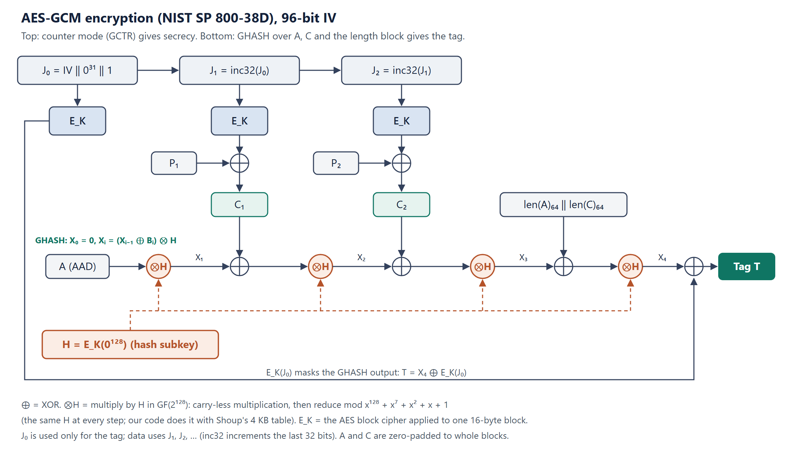
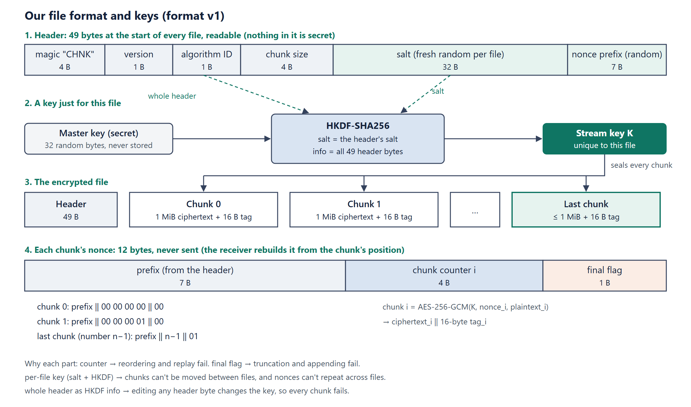
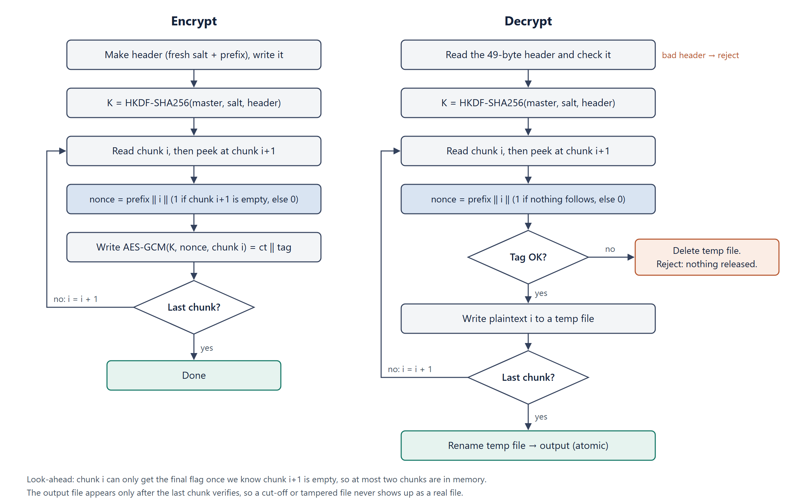

# Study guide: Streaming AEAD over AES-GCM (Group 4)

Everything in our project, explained from zero: what each part does, why it's there, what else we could have done, and why we didn't. Read it once top to bottom (about 45 minutes). Before the viva, re-read Part 4 (the slides) and Part 6 (the questions).

**Contents**
1. [Crypto from zero](#part-1-crypto-from-zero)
2. [How AES-GCM works](#part-2-how-aes-gcm-works)
3. [Our design, piece by piece](#part-3-our-design-piece-by-piece)
4. [The slides, one by one](#part-4-the-slides-one-by-one)
5. [Where every number comes from](#part-5-where-every-number-comes-from)
6. [Viva question bank](#part-6-viva-question-bank)
7. [Glossary](#part-7-glossary)

**The whole project in five sentences.** AES-GCM is the standard way to encrypt data so it's both secret and tamper-proof, but it works on one whole message at a time. For a huge file, that means huge memory, and NIST forbids messages over 64 GiB. So we cut the file into 1 MiB chunks and encrypt each one separately. Doing that naively lets an attacker delete, shuffle, repeat or swap chunks, so we tie every chunk to its file (a key per file), its position (a counter) and whether it's the last one (a flag). We also built GCM itself from its maths, proved it correct against NIST's official tests, attacked a naive design five ways, and measured everything.

---

## Part 1: Crypto from zero

### Bits, bytes, blocks, hex
- A **bit** is 0 or 1. A **byte** is 8 bits (a number 0–255).
- AES works on **blocks** of 16 bytes = 128 bits.
- **Hex** writes a byte as two characters 00–ff, so 16 bytes = 32 hex characters.
- **KiB, MiB, GiB, TiB, PiB** are powers of 2: 2¹⁰, 2²⁰, 2³⁰, 2⁴⁰ and 2⁵⁰ bytes. 1 MiB = 1,048,576 bytes.

### XOR (⊕)
XOR compares two bits and outputs 1 if they're different: 0⊕0 = 0, 1⊕1 = 0, 0⊕1 = 1. On bytes, it works bit by bit.

The magic property: **XOR the same thing twice and it cancels out.** (A ⊕ K) ⊕ K = A. That's how we encrypt with a keystream and decrypt by doing the same thing again.

### Key, plaintext, ciphertext
- **Key:** a secret random number. Ours is 256 bits (32 bytes), so there are 2²⁵⁶ possible keys and guessing is hopeless.
- **Plaintext:** the readable data.
- **Ciphertext:** the scrambled data.

### Block cipher (AES) and what E_K means
**AES** is a keyed scrambler for one 16-byte block: put in a block, get out a different-looking block. With the key you can reverse it; without the key the output looks like random noise.

We write **E_K(X)** for "AES with key K applied to block X". It's a **permutation**: every input maps to a different output.

### Why ECB is bad, and why GCM doesn't use it
**ECB mode** means "encrypt each 16-byte block of the message with E_K on its own". Its problem: two identical plaintext blocks give identical ciphertext blocks, so patterns leak. The famous example is an encrypted image of a penguin where you can still see the penguin.

GCM never feeds plaintext into AES. It only encrypts **counter values** (all different) and one block of zeros. That's why sir said "there should be no AES-ECB": GCM is defined using **E_K** (AES on one block) and its own **counter mode**, never ECB mode.

### Counter mode (CTR): a keystream
Take counter blocks 1, 2, 3, …, encrypt each with E_K to get random-looking bytes called the **keystream**, and XOR the keystream onto the plaintext.

- **Advantages:** fast, works for any length, no padding.
- **Problem:** CTR is **malleable**. Flipping a ciphertext bit flips the same plaintext bit. If you know a message says "PAY 100", you can turn it into "PAY 900" without the key. Encryption alone gives **secrecy, not integrity**.

### MAC / tag, AEAD, associated data
- **MAC (Message Authentication Code):** a short keyed fingerprint of the data, called the **tag** (16 bytes for us). Change one bit and the tag no longer matches; only someone with the key can make a valid tag.
- **AEAD (Authenticated Encryption with Associated Data):** encryption plus a tag in one tool. AES-GCM is an AEAD.
- **Associated data (AAD):** extra data that stays readable but is still covered by the tag, like an address on a sealed envelope. (We don't use AAD; Part 3 explains why.)

### Nonce: number used once
Every GCM message needs a 12-byte **nonce** (also called the IV). It isn't secret, but **it must never repeat under the same key.**

**Why:** same key + same nonce = same keystream. XOR two ciphertexts made with the same keystream and the keystream cancels, leaving plaintext₁ ⊕ plaintext₂. That leaks information. In GCM it's even worse: it also exposes the hash key H, which lets an attacker forge tags (the **forbidden attack**, Part 2).

### Verify-then-release
The decryptor must check the tag **before** handing out any plaintext. If it released data first, an attacker could have changed it and you'd act on forged data. This single rule is why one-shot GCM needs the whole file in memory: the tag comes at the very end.

### Hash, HMAC, KDF
- **Hash function (SHA-256):** a blender. Any input gives a 32-byte fingerprint, and you can't reverse it.
- **HMAC-SHA256:** a hash with a secret key mixed in.
- **KDF (Key Derivation Function):** makes new keys from an existing secret. HKDF is a KDF built from HMAC.

### The birthday paradox
In a room of 23 people there's a 50% chance two share a birthday, even though there are 365 days. With N possible values, collisions become likely after about √N picks; the chance after n picks is about **n² / (2N)**.

This is why random nonces can collide, and why security bounds have "squared" terms.

### "Advantage" and numbers like 2⁻⁶⁵
- **Advantage** means how much better than blind guessing an attacker can do.
- **2⁻⁶⁵·⁷** is about 1 in 6 × 10¹⁹ (60 billion billion).
- **2⁻⁹⁶·⁴** is about 1 in 10²⁹.
- Smaller is safer. Each −1 in the exponent halves the chance; −10 divides it by about 1,000.

---

## Part 2: How AES-GCM works

*Our own diagram, drawn from the NIST standard SP 800-38D. It replaced the copied figure sir said was wrong.*

**GCM = counter mode (secrecy) + GHASH (the tag).**

### Top half: encryption
1. **J₀ = IV ‖ 0³¹ ‖ 1.** "‖" means "joined together". The 12-byte IV (96 bits), then 31 zero bits, then a 1, makes 128 bits = one block. J₀ is the **pre-counter block** and is **only used for the tag**.
2. **J₁ = inc32(J₀), J₂ = inc32(J₁), …** "inc32" adds 1 to the **last 32 bits only** (wrapping around at 2³²). So J₁ ends in …0002, J₂ in …0003.
3. **E_K(J₁), E_K(J₂)** form the keystream; **C₁ = P₁ ⊕ E_K(J₁)**, **C₂ = P₂ ⊕ E_K(J₂)**. P is plaintext, C is ciphertext.

### Bottom half: GHASH and the tag
1. **H = E_K(0¹²⁸)**: AES of a block of 128 zero bits. This is the **hash subkey**. It's secret because K is secret. The dashed orange lines show H is used at every ⊗H.
2. GHASH runs over the blocks **A (associated data), C₁, C₂, … and then the length block len(A)₆₄ ‖ len(C)₆₄** (the bit lengths of A and C, 64 bits each).
3. Start with **X₀ = 0**. For each block B: **X ← (X ⊕ B) ⊗ H**. That gives X₁, X₂, X₃, X₄ on the diagram.
4. **Tag T = X₄ ⊕ E_K(J₀).** The long line from the left-hand E_K box carries E_K(J₀) to the last ⊕.

**Why each part is there:**
- **The mask E_K(J₀):** without it, the tag would be a plain polynomial in H with known coefficients, and an attacker could solve for H.
- **The length block:** fixes exactly where A ends and C begins. Without it, an attacker could move bytes between A and C, or add zero-padding, and get the same hash.
- **Order on decryption:** compute the tag over the received ciphertext **first**, compare in constant time, and only then decrypt. Our `ref_gcm.py` does exactly this.

### What ⊗H means: arithmetic in GF(2¹²⁸)
GF(2¹²⁸) is a "Galois field" with 2¹²⁸ elements. In plain words:
- **A 128-bit block is a polynomial** whose coefficients are its bits. For example, bits 1011 mean 1 + x² + x³ (GCM reads the bits in reverse order, see below).
- **Adding is XOR.** There are no carries, because 1 + 1 = 0.
- **Multiplying:** multiply the polynomials, then take the **remainder after dividing by x¹²⁸ + x⁷ + x² + x + 1**, so the answer stays 128 bits. Like clock arithmetic: on a clock 9 + 5 = 2, and here anything past x¹²⁷ "wraps around".

**Tiny worked example**, using the 3-bit field with modulus x³ + x + 1:
- (x + 1)·(x² + 1) = x³ + x² + x + 1.
- The modulus tells us x³ = x + 1 (because x³ + x + 1 = 0, and minus is the same as plus).
- So the result is (x + 1) + x² + x + 1 = x², because the two x's cancel and the two 1's cancel.
- In bits: 011 × 101 = 100. GF(2¹²⁸) does exactly this with 128 bits.

**Why a field matters:**
- Every non-zero element has an inverse, so you can divide.
- A polynomial of degree ℓ has **at most ℓ roots**.

That gives GCM's forgery bound. To forge, an attacker must change the message without changing the tag, which means H must be a root of the "difference polynomial". With ℓ blocks there are at most ℓ bad values of H among 2¹²⁸, so **one forgery attempt succeeds with probability about ℓ / 2¹²⁸.**

**GCM's bit-order quirk:** the leftmost bit is the x⁰ coefficient. So the number "1" is written 0x80 00 … 00, and "multiply by x" is a **right** shift.

### Shoup's table (how we made GHASH fast)
- **The textbook method** multiplies bit by bit: 128 steps for every block.
- **The idea:** H is the same for the whole message. So we precompute **H × every possible byte value** (256 entries × 16 bytes = **4 KB**).
- **Result:** multiplying any block by H takes 16 table lookups plus 15 one-byte shifts.
- **Fix-up table:** shifting by a byte pushes 8 bits off the end, and a second small 256-entry table puts their effect back.
- **Cheap to build:** we fill the 4 KB table with only 8 real multiplications (not 256), because multiplication distributes over XOR. Each entry is the XOR of the entries for its individual bits.
- **Measured:** GHASH runs **6.3× faster**.
- **Other sizes exist:** a 256 B table (4-bit chunks, smaller but slower) or a 64 KB table (no shifts, more memory). 4 KB is the classic middle ground.

### Where "64 GiB" comes from
The counter part of the counter block is 32 bits, so it has 2³² values.
- **Value 1** is J₀, reserved for the tag.
- **Value 0** would only appear after the counter wraps, and wrapping would reuse J₀'s keystream.
- So data can use values 2 … 2³²−1, which is **2³² − 2 blocks**.

That gives (2³² − 2) × 128 bits = 2³⁹ − 256 bits = 2³⁶ − 32 bytes ≈ **64 GiB**. NIST SP 800-38D forbids longer messages.

### The forbidden attack (nonce reuse)
If two messages use the same key and nonce:
1. Same keystream, so C₁ ⊕ C₂ = P₁ ⊕ P₂: the plaintext leaks.
2. Both tags use the same H and the same mask E_K(J₀). XOR the two tags and the mask cancels, leaving a polynomial equation in H. Solve it to get H, then forge tags for anything.

Our attack 5 does exactly this (Part 3, item 16).

---

## Part 3: Our design, piece by piece

Each item: **what**, **why**, and **alternatives we rejected**.

### 1. Chunking at all
- **What:** cut the file into 1 MiB pieces and encrypt each with its own GCM call.
- **Why:** memory stays at about one chunk (we measured 3.02 MiB, against 512 MiB for one-shot GCM on a 256 MiB file), and every call is far under 64 GiB.
- **Alternatives:**
  - *One-shot GCM:* needs the whole file in memory, and is capped at 64 GiB.
  - *The "streaming" GCM API (`update()` … `finalize()`):* hands out plaintext before the tag at the end is checked, which breaks verify-then-release.
  - *Buy more RAM:* doesn't fix the 64 GiB legal limit.

### 2. Chunk size = 1 MiB
- **Why:** we **measured** instead of copying a library. Every size from 16 KiB up runs faster than a typical SSD, so speed doesn't decide it.
- **Alternatives:**
  - *4 KiB:* 0.39% of the file becomes tags, and it's slow.
  - *64 KiB* (what age uses): fastest in memory, but max file 2³² × 64 KiB = 256 TiB, below our PRD's 1 PiB requirement.
  - *256 KiB:* speed swung between 2 and 8 GB/s from run to run, because it sits at the edge of the CPU cache.
  - *16 MiB:* more memory for almost no gain.
- **What 1 MiB gives:** stable at about 2.5 GB/s, 0.0016% overhead, 4 PiB maximum.
- The chunk size is **stored in the header**, so files with any allowed size still decrypt.

### 3. The header (49 bytes, readable, nothing secret)

| Field | Size | Why it's there | Simpler alternative and why not |
|---|---|---|---|
| Magic "CHNK" | 4 B | Instantly reject files that aren't ours, with a clear error | None: you'd get a confusing "authentication failed" on any random file |
| Version | 1 B | Lets the format change later without misreading old files | None: without it, any format change breaks old files silently |
| Algorithm ID | 1 B | Names the cipher, e.g. a future ChaCha20-Poly1305 option | Could be folded into version; kept separate so "layout" and "cipher" can change independently |
| Chunk size | 4 B | Decryptor must know where each chunk ends *before* checking anything | Fixed size in code: inflexible. Capped at 16 MiB so a forged header can't make us read gigabytes first |
| Salt | 32 B | Fresh random per file; makes the file's key unique (item 4) | 16 B would also be safe (age uses 16); 32 B is RFC 5869's recommendation (= SHA-256 output size) |
| Nonce prefix | 7 B | Random; first 7 bytes of every nonce | Honestly *not strictly needed*: the per-file key already makes nonces unique. Kept as cheap defence in depth; matches Google Tink's layout |

4 + 1 + 1 + 4 + 32 + 7 = **49 bytes**.

**Why isn't the header encrypted?** Nothing in it is secret: salt and prefix are public by design, like any nonce. It's still **protected**, through item 5.

### 4. A key per file: HKDF-SHA256 (sir's question)
**What:** K_file = HKDF-SHA256(input = master key, salt = header's salt, info = all 49 header bytes), giving 32 bytes.

**How HKDF works:**
- **Extract:** PRK = HMAC(salt, master key). This mixes in the randomness and gives a uniform key.
- **Expand:** K = HMAC(PRK, info ‖ 0x01). This makes the final key, labelled by `info`.
- Different salt or info gives an unrelated key. Same inputs give the same key, so the decryptor can recompute it from the header. It's one-way: knowing K_file doesn't reveal the master key.

**Why it's necessary.** Without it, every file uses the master key directly:
1. **Nonces repeat across files.** A file's nonces are its random 7-byte prefix plus a counter. Two files that pick the same prefix reuse *every* nonce, which is the forbidden attack. By the birthday paradox, the chance of some two of n files sharing a 56-bit prefix is about n²/2⁵⁷: **1 in 130,000 at a million files, about 7% at 100 million.** With per-file keys, a clash needs two equal 32-byte salts: about n²/2²⁵⁷, effectively never.
2. **Splicing:** a chunk cut from file A would decrypt fine inside file B.
3. **The header isn't protected:** editing chunk size or algorithm ID would go unnoticed.
4. **Shared security budget:** GCM's security weakens with total data under one key, so per-file keys give each file a fresh budget.
5. **Odd master keys:** if the master key isn't a perfect 256-bit random string, HKDF's extract step fixes that.

**Alternatives we rejected:**
- *Master key + header as AAD:* fixes point 3 only.
- *Random 96-bit nonce per chunk, one key:* collisions possible (q²/2⁹⁷, adding up over all files), and you'd *still* need a counter and flag for order and completeness.
- *Envelope encryption* (random file key, encrypted with the master key, stored in the header): also correct, but every file then stores a 40–60-byte wrapped key and needs a second encryption step. HKDF does the same job from a public salt.
- *Plain SHA-256(master ‖ salt):* ad hoc. HKDF is the standard, analysed construction (used by TLS 1.3, Tink and age), and `info` gives header binding for free.

### 5. Binding the header through HKDF's `info` (not AAD)
- **What:** all 49 header bytes are the HKDF label. Change any byte and you get a different key, so **every** chunk's tag fails. This is "implicit authentication".
- **Alternative:** pass the header as AAD to chunk 0, or to every chunk. That works too, but HKDF covers every chunk at once with no special case, and it also stops "downgrade" edits to the version or algorithm ID.
- **Detail:** we still **range-check** the header before using it (magic, version, algorithm, chunk size 16 B–16 MiB), because we need chunk size to read the first chunk *before* any tag can be checked.

### 6. The nonce: prefix (7 B) ‖ counter (4 B) ‖ final flag (1 B) = 96 bits
- **Counter** (chunk number 0, 1, 2, …): ties each chunk to its position, which stops **reordering and replay**. It also makes nonces in a file unique **by construction**: the chance of a repeat is exactly 0, not just small. At chunk 2³² we raise `CounterOverflowError` instead of wrapping to 0, since wrapping = nonce reuse. 2³² chunks × 1 MiB = **4 PiB** maximum.
- **Final flag** (1 on the last chunk only): stops **truncation** (a cut-off stream ends on a chunk sealed with flag 0) and **appending** (the real last chunk, sealed with flag 1, is no longer last).
- **The nonce is never stored.** The receiver rebuilds it from the prefix, the chunk's position, and whether anything follows. An attacker can't "fix" a moved chunk by editing its nonce, because changing the nonce means re-sealing, which needs the key.
- **96 bits:** GCM's fast path (J₀ = nonce ‖ 0³¹ ‖ 1 directly). Other lengths need an extra GHASH of the nonce, and the original GCM security proof was found flawed for them (Iwata, Ohashi and Minematsu, 2012).
- **Alternatives:**
  - *Random nonce per chunk, stored with it:* the nonce says nothing about position (attacks 2–3 work), and collisions are possible.
  - *Put the chunk index and flag in AAD instead:* would also work, but you'd still need unique nonces. Putting them in the nonce gives position, end marker *and* uniqueness at once, with nothing extra stored. This is what Tink and age do.

### 7. Look-ahead by one chunk
- **What:** read chunk i+1 before sealing chunk i. If chunk i+1 is empty, chunk i is the last one, so it gets flag 1.
- **Why:** you can't know a chunk is last until you try to read the next one. It costs one extra chunk in memory.
- **Alternative:** write the total length or chunk count in the header first. That's impossible for a pipe or socket, where you don't know the length in advance, and it means rewriting the header at the end.
- **Empty file:** we still write one empty final chunk (just a 16-byte tag), so "attacker deleted all chunks" is detected.

### 8. Verify-then-write, temp file, atomic rename
- **What:** each chunk's tag is checked **before** its plaintext is written. Plaintext goes into a **uniquely named temporary file**. Only after the last chunk verifies do we `os.replace()` it to the real name; on any failure the temp file is deleted.
- **Why:** truncation can only be noticed at the end. Without the temp file, a cut-off stream would leave a real-looking partial file behind.
- **Atomic** means the rename happens in one indivisible step: anyone looking sees either nothing or the complete verified file. We "relax all-or-nothing per chunk, and restore it per file".
- **Alternatives:**
  - *Write straight to the output:* leaves partial files behind.
  - *Hold everything in memory until the end:* that's the one-shot problem again.

### 9. Single-use encryptor; randomness drawn at encryption time
- The salt and prefix are created inside `StreamEncryptor` and **cannot be passed in**. Calling `encrypt` twice on one instance raises an error.
- **Why:** a retry or a copy-pasted header would otherwise reuse a (key, nonce) pair.

### 10. `_read_full` (reading exactly one chunk)
- Sockets and pipes can return fewer bytes than asked for, in the middle of a stream. Treating that as end-of-file would mark a chunk as final by mistake.
- So we keep reading until the chunk is full or the stream really ends.
- For normal files the first read is already complete, and we skip the extra copy. That's what brought memory from 4.02 down to 3.02 MiB.

### 11. AES from the library; GCM written ourselves
- **AES:** from the `cryptography` library (OpenSSL). Writing AES is a solved problem, and a Python AES would leak timing. The PRD made it a non-goal.
- **GCM** (counter mode, GHASH, the field maths, the tag): written by us. That's Phase I, to understand it.
- **Two backends** (`chunk_aead.py`): the stream uses OpenSSL by default (fast). Switching to ours gives **byte-identical** files, and we test both directions. This answered the midsem limitation "not integrated".
- **Ours is ~700× slower** than OpenSSL. OpenSSL uses CPU instructions: **AES-NI** (AES in hardware) and **PCLMULQDQ** (carry-less multiply, the core of a GF(2¹²⁸) multiply). Ours is also not constant-time, so it's for proof and teaching, not real data.

### 12. No ECB: E_K and GCTR built on CTR mode (sir's point 1)
- **Before:** we called the library's `modes.ECB()` on one block at a time to reach raw AES. The output was the same, but it was conceptually wrong: GCM is defined with E_K and GCTR only.
- **Now:**
  - **E_K(X):** run the library's **CTR mode** starting at block X over 16 zero bytes. The output is E_K(X) ⊕ 0 = E_K(X).
  - **GCTR:** the library's CTR mode directly.
- **One subtlety:** the library's CTR adds 1 to all 128 bits, but GCM's inc32 only to the last 32. They differ only when the low 32 bits wrap, so we restart CTR at that point. A test checks the wrap, and another fails if `modes.ECB` ever appears in our code. All 47,250 NIST tests still pass.
- **Alternative:** write AES ourselves to get "raw" AES. Out of scope and riskier.

### 13. Exception types
- **`HeaderError`** means not our file, or a malformed one. **`AuthenticationError`** means tampered, wrong key or truncated. **`CounterOverflowError`** means the file is too big.
- They let the command-line tool say clearly what went wrong. All are a kind of `ValueError`.

### 14. Command-line tool (`cli.py`)
- `keygen` writes 32 random bytes as hex and refuses to overwrite an existing key.
- `encrypt` and `decrypt` work on files, and `encrypt` also works with pipes.
- **Decrypt only writes to a file, never to the screen.** Printing as you go would show data before truncation could be detected.

### 15. Socket demo (`socket_demo.py`)
- Sends a 10 MiB file over TCP, decrypting as it arrives.
- **Why:** a network stream can't be rewound, which proves the design works in one pass. If the connection is cut after 5 MiB, the receiver rejects it and no output file appears.

### 16. Naive design + attack suite (`naive.py`, `attacks.py`)
**`naive.py`** is "AES-GCM in a loop": the master key for every chunk of every file, a random nonce stored with each chunk, no final flag.

| Attack | Attacker does | Naive | Ours | What stops it |
|---|---|---|---|---|
| Truncation | Drops the last chunk | accepted | rejected | Final flag |
| Reordering | Swaps chunks 0 and 1 | accepted | rejected | Counter |
| Replay | Repeats chunk 1 | accepted | rejected | Counter |
| Splicing | Puts a chunk from another file in | accepted | rejected | Per-file key |
| Nonce reuse | Recovers H, forges a message | accepted | rejected | Per-file key + counter |

**Attack 5 maths** (two 16-byte messages, same key and nonce, no AAD):
- GHASH of one block C is C·H² ⊕ L·H, where L is the length block, so the tag is T = C·H² ⊕ L·H ⊕ E_K(J₀).
- XOR the two tags: the L·H and E_K(J₀) parts are identical and cancel, leaving **T₁ ⊕ T₂ = (C₁ ⊕ C₂)·H²**.
- So H² = (T₁ ⊕ T₂) / (C₁ ⊕ C₂). Division is allowed because it's a field.
- Every element has exactly one square root in GF(2¹²⁸), and the square root of y is y^(2¹²⁷). That gives **H exactly**.
- Then E_K(J₀) = T₁ ⊕ GHASH(C₁). Knowing P₁ gives the keystream (C₁ ⊕ P₁). Now we can make a ciphertext and tag for "PAY EVE 99999.99", and the naive decryptor accepts it.
- **Against ours:** we force two files to share a nonce prefix, but their salts, and so their keys, differ. The algebra produces garbage and the forgery is rejected.

Attacks 1–4 never break GCM; they only move whole, valid chunks. Attack 5 breaks GCM itself.

### 17. Benchmarks (`bench/bench.py`)
They measure throughput vs chunk size, memory (streaming vs one-shot), and our GCM vs OpenSSL. They exist so every number we quote is measured, not assumed.

### What we removed (and why, if asked)
- **Redundant demo files:** a single-chunk mode and its demo (a one-chunk file is just the stream with one chunk), and an ad-hoc test script.
- **Duplicate NIST runners:** old ones that also skipped 10,822 tests.
- **ECB.**

---

## Part 4: The slides, one by one

The final deck has 16 slides. For each: what's on it, what it means, and a line to say. A "Q" points to Part 6.

### Slide 1: Title
**On it:**
- "Streaming AEAD over AES-GCM" means AEAD (encryption + tamper-proofing) applied to a stream, using AES-GCM.
- "Constant memory" means memory doesn't grow with file size.
- "Same security bounds as one-shot GCM" means chunking makes nothing weaker (slide 13).

**Say:** "We encrypt files of any size in about 3 MiB of memory, using standard AES-GCM, without making it weaker. We built GCM itself to understand it, then the format, the engine, attacks and measurements."

### Slide 2: Every point raised at the midsem is fixed
Six rows:
- **No ECB** (Part 3 #12).
- **HKDF justified** (#4).
- **Diagram redrawn** (Part 2).
- **Our GCM integrated** (#11).
- **47,250 not 36,428:** the old runner ignored lines like `PT = ` with nothing after "=", so records with empty plaintext or AAD were never tested. 10,822 were skipped.
- **Decryption memory measured:** 3.02 MiB, the same as encryption. "Was 4.02" because we removed one extra copy per chunk.

**Say:** "Sir raised three points; all are fixed, plus three things we found ourselves."

### Slide 3: One GCM call cannot handle a huge file
- **Wall 1, memory:** verify-then-release, and the tag comes at the end. **512 MiB** is measured: one-shot GCM on a 256 MiB file holds the whole input plus the whole output.
- **Wall 2, the limit:** (2³² − 2) × 128 bits = 2³⁹ − 256 bits ≈ **64 GiB** (Part 2).
- **Bottom line:** chunking fixes both, but naive chunking is dangerous.

### Slide 4: "AES-GCM in a loop" lets valid chunks be rearranged
The table of 5 attacks, with columns for what the attacker does, why naive accepts it, and our fix (Part 3 #16).

**Analogy:** a book mailed as sealed envelopes. The seals prove nobody opened one, but not the page number, whether pages are missing, or which book it's from.

### Slide 5: GCM = counter mode + GHASH (our diagram)
Every symbol is in Part 2.
- **Left of the diagram:** J₀ = IV ‖ 0³¹ ‖ 1; inc32; E_K; P₁, P₂; C₁, C₂; A (AAD); len(A)₆₄ ‖ len(C)₆₄; the ⊗H circles; the dashed lines from H; X₁–X₄; the E_K(J₀) mask line; Tag T.
- **Side card:**
  - J₀ masks the tag; data uses J₁, J₂, …
  - E_K is AES on one block, no ECB mode.
  - H = E_K(0¹²⁸) is used at every ⊗H.
  - ⊗H is multiplication in GF(2¹²⁸).
  - T = GHASH ⊕ E_K(J₀), and the mask stops anyone solving for H.

**Say:** "Top half: counter mode. Bottom half: GHASH, a polynomial in the secret H, masked to make the tag."

### Slide 6: GHASH runs on arithmetic in GF(2¹²⁸)
- **Left card:** the four rules of the field (Part 2).
- **Right card:** Shoup's 4 KB table, measured 6.3× faster.
- **The strip:** X₀ = 0, Xᵢ = (Xᵢ₋₁ ⊕ Bᵢ)·H gives GHASH = B₁·H^m ⊕ B₂·H^(m−1) ⊕ … ⊕ Bₘ·H. In words: the loop of "XOR then multiply" (Horner's method) is the same as evaluating a polynomial whose coefficients are the blocks, at the point H.

### Slide 7: Our GCM matches NIST and OpenSSL exactly
- **47,250:** NIST CAVS 14.0 test files, 6 files × 7,875 records (encrypt and decrypt, 128/192/256-bit keys, short tags, IVs of different lengths).
- **"Both directions":** we must produce NIST's exact ciphertext and tag, decrypt back, and *reject* the records marked FAIL.
- **Checks:**
  - **Byte-identical to OpenSSL** on random inputs.
  - **No ECB.**
  - **1,368 failures:** if we corrupt one entry of the reduction table, 1,368 tests in one file fail. That proves the tests actually catch mistakes.
  - **About 1 s per file:** at the midsem it was 30–45 s, because the table was rebuilt the slow way for every test and a new AES object was made for every block.

### Slide 8: Why HKDF is necessary
- **The strip:** the formula (Part 3 #4).
- **Orange card:** the 4 problems without it, including **1 in 130,000** at a million files.
- **White card:** the 3 alternatives and why not.

**Say:** "HKDF gives each file its own key from a random salt. Without it, nonces repeat across files, chunks move between files, and the header isn't protected."

### Slide 9: Header, key and nonce: every byte has a job
- **The diagram:** Part 3 #3–#6.
- **The side card** lists why each field exists. The "Prefix: defence in depth" line is the honest one; see Part 3 #3.

### Slide 10: Look ahead, verify before writing, rename at the end
The flowchart (Part 3 #7–#9).
- **Encrypt side:** make header → derive key → read chunk i, peek at i+1 → nonce with flag → write ciphertext and tag → loop.
- **Decrypt side:** check header → derive key → rebuild nonce → **Tag OK?** (no → delete temp, reject) → write to temp → last? → **rename (atomic)**.

### Slide 11: All five attacks break the naive design; none break ours
- **Table:** the 5 attacks.
- **Card:** attack 5's maths (Part 3 #16): T₁ ⊕ T₂ = (C₁ ⊕ C₂)·H², so H = √(…), and the recovered H equals the real H.

### Slide 12: 3 MiB of memory, whatever the file size
- **3.02 MiB:** measured with Python's `tracemalloc` for encrypt and decrypt, for 5 and 50 MiB files. It's three 1 MiB buffers: the current chunk, the look-ahead chunk, and the output.
- **Table:** throughput, overhead and max file size per chunk size. The asterisk on 256 KiB marks the unstable result (Part 3 #2).
- **~700×:** our GCM vs OpenSSL (Part 3 #11).
- **Footer:** the machine the numbers were measured on.

### Slide 13: Chunking is bound-neutral
Each row is in Part 5.

**"Bound-neutral"** means chunking makes no security number worse. It only holds because nonces never repeat and each file has its own key.

The fine print is the formula, plus what we don't claim (Part 6).

### Slide 14: Live demo
- The command-line tool and the socket demo (Part 3 #14–#15).
- **Commands to run live:** `python attacks.py`, `python nist_parser.py`, `python -m pytest test -q`.

### Slide 15: What we don't claim, and what's next
**Not covered:**
- **Whole-file rollback:** swapping in an *older genuine* version can't be detected without version numbers.
- **A broken random generator:** e.g. a VM snapshot restored twice gives two files the same salt and prefix.
- **4 PiB is capacity, not safety:** at that size the bound is about 2⁻³³.
- **Our Python GCM isn't constant-time.**
- **Key management** is out of scope.

**Next:**
- **Argon2 for passwords:** a password isn't random enough for HKDF directly.
- **A ChaCha20-Poly1305 algorithm ID**, for CPUs without AES-NI.
- **Random access:** decrypt chunk i alone, which works because nonces depend only on position.
- **Version numbers inside files**, to detect rollback.

### Slide 16: Summary
Four takeaways, then "Questions?".

---

## Part 5: Where every number comes from

| Number | Where it comes from |
|---|---|
| **49 bytes** header | 4 + 1 + 1 + 4 + 32 + 7 |
| **12-byte nonce** | 7 + 4 + 1 = 96 bits, GCM's fast path |
| **16-byte tag** | Full-length GCM tag (128 bits); we never shorten it |
| **≈ 64 GiB** | (2³² − 2) blocks × 16 B = 2³⁶ − 32 B |
| **4 PiB** | 2³² chunks × 2²⁰ B = 2⁵² B |
| **0.0016 %** overhead | 16 B tag per 1,048,576 B chunk |
| **51,200 chunks** | 50 GiB ÷ 1 MiB |
| **σ ≈ 2³¹·⁶⁴ blocks** | 50 GiB ÷ 16 B = 3,355,443,200 |
| **2⁻⁶⁵·⁷** | McGrew–Viega Theorem 1: (σ + 2q)² / 2¹²⁹ = (2³¹·⁶⁴)² / 2¹²⁹. With q = 51,200, σ + 2q grows by only 0.003%, so it's still the same |
| **2⁻⁹⁶·⁴** per guess, one-shot | ℓ / 2¹²⁸ with ℓ = 2³¹·⁶⁴ blocks |
| **2⁻¹¹²** per guess, per chunk | 2¹⁶ blocks (1 MiB ÷ 16 B) / 2¹²⁸ |
| **2⁻⁹⁶·⁴** total, ours | 51,200 chunks × 2⁻¹¹² = 2¹⁵·⁶ × 2⁻¹¹² |
| **1 in 130,000** | Birthday: n² / 2⁵⁷ with n = 2²⁰ files gives 2⁻¹⁷ |
| **≈ 7 %** | Same formula, n = 100 million |
| **2⁻¹⁷⁷** | Salt clash: n² / 2²⁵⁷ with n = 2⁴⁰ files |
| **q² / 2⁹⁷** | Random 96-bit nonces colliding (birthday) |
| **2⁻³³** | Theorem 1 at 4 PiB: σ = 2⁴⁸, so 2⁹⁶ / 2¹²⁹ |
| **47,250** | 6 NIST files × 7,875 records |
| **36,428 / 10,822** | What the old runner counted / what it skipped |
| **3.02 MiB** | Three ~1 MiB buffers alive at once |
| **512 MiB** | One-shot: the 256 MiB input + 256 MiB output in memory |
| **~700×** | 162 ms (ours) vs 0.23 ms (OpenSSL) per 1 MiB chunk |
| **6.3×** | GHASH with Shoup's table vs bit by bit (10 ms vs 63 ms per 64 KiB) |

**Why 2¹²⁹ and not 2¹²⁸?** The midsem used the rough rule σ² / 2¹²⁸, which gives 2⁻⁶⁴·⁷. The theorem's exact form divides by 2^(128+1), giving 2⁻⁶⁵·⁷. We quote the theorem.

---

## Part 6: Viva question bank

### Basics
- **What is AEAD?** Encryption plus a tamper-proof tag in one tool. It can also protect readable "associated data".
- **Why isn't encryption alone enough?** CTR-style encryption is malleable: flip a ciphertext bit and the same plaintext bit flips, undetected.
- **What's the difference between a hash and a MAC?** Anyone can compute a hash. A MAC needs the secret key, so only key-holders can make a valid tag.
- **What is a nonce and why must it never repeat?** A per-message number, not secret. Repeating one under the same key repeats the keystream, which leaks the XOR of the plaintexts, and in GCM also exposes H.
- **Why is ECB insecure?** Equal plaintext blocks give equal ciphertext blocks, so patterns leak.
- **Isn't GCM using ECB inside?** No. It uses E_K, the block cipher itself, on counter blocks (which are always different) and one zero block. That's why we removed `modes.ECB` from our code.

### GCM
- **Define GHASH.** GCM's keyed hash: X ← (X ⊕ block)·H over AAD, ciphertext and the length block. It evaluates a polynomial at the secret point H.
- **What is H? Why must it be secret?** H = E_K(0¹²⁸). Anyone who knows H can forge tags.
- **Why mask with E_K(J₀)?** Without the mask, the tag would be a known polynomial in H, so H could be solved for.
- **Why the length block?** It fixes where AAD ends and ciphertext begins, and stops padding tricks.
- **What does inc32 do?** Adds 1 to the last 32 bits of the counter block, wrapping at 2³².
- **Why 64 GiB?** (2³² − 2) blocks × 128 bits = 2³⁹ − 256 bits.
- **How does decryption work?** Recompute the tag over the ciphertext, compare in constant time, and decrypt only if it matches.
- **What is GF(2¹²⁸)?** Polynomials with bit coefficients, XOR for addition, multiplication reduced mod x¹²⁸ + x⁷ + x² + x + 1.
- **Why that polynomial?** It's irreducible (can't be factored), which makes it a field. It's also sparse, so reduction is cheap.
- **Why is forging hard?** The changed message must give the same GHASH, which means H has to be a root of a degree-ℓ polynomial. That's at most ℓ chances out of 2¹²⁸.
- **What is Shoup's method?** A 4 KB table of H × every byte, so each multiply is 16 lookups instead of 128 bit-steps. 6.3× faster.
- **Did you write AES?** No, by design. We use OpenSSL's AES and wrote everything else in GCM.
- **How do you know your GCM is right?** All 47,250 NIST vectors pass, it matches OpenSSL byte for byte, it passes field-law tests, and the tests are shown to catch injected bugs.
- **Why is yours 700× slower?** Python versus the CPU's AES-NI and PCLMULQDQ instructions.
- **Is your GCM constant-time?** No, so it isn't used for real data; OpenSSL's is constant-time.
- **What is GMAC?** GCM with no plaintext, used as a MAC only.

### Design
- **Why chunk at all?** Memory (verify-then-release with the tag at the end) and the 64 GiB limit.
- **Why not AES-GCM-SIV or ChaCha20-Poly1305?** They're one-shot too, with the same memory problem. Chunking is a layer on top; age does it with ChaCha20.
- **Why HKDF?** Part 3 #4: cross-file nonce reuse (1 in 130,000 at 1 M files), splicing, header binding, a fresh security budget per file.
- **Why not just SHA-256(master ‖ salt)?** HKDF is the standard, analysed construction, and `info` gives header binding for free.
- **Why bind the header via HKDF and not AAD?** It covers every chunk with no special case. AAD would work too.
- **Why isn't the header encrypted?** Nothing in it is secret, and it's protected through the key.
- **What if someone changes the chunk size?** If it's out of range, the header parser rejects it. If it's in range, the key changes and the first chunk fails.
- **What if someone swaps headers between files?** The salt and key change, so every chunk fails.
- **Why a counter, not random nonces?** A counter can't repeat within a file (probability 0). Random nonces collide by the birthday paradox and say nothing about position.
- **Why is the nonce 96 bits?** GCM's fast path, and the original proof was flawed for other lengths.
- **Why put position in the nonce and not AAD?** One field gives position, the end marker and uniqueness, with nothing stored.
- **Why have the 7-byte prefix at all?** Honestly, defence in depth: the per-file key already guarantees unique nonces. It's 7 bytes and matches Tink.
- **Why 32-byte salt and not 16?** RFC 5869 recommends a salt the length of the hash output. 16 would also be fine.
- **Why look-ahead, not storing the length in the header?** The length isn't known in advance for pipes and sockets.
- **What happens with an empty file?** One empty final chunk (16-byte tag) is written, so deleting all chunks is detected.
- **What if the file is an exact multiple of 1 MiB?** The look-ahead read comes back empty, so the last full chunk gets flag 1.
- **Could an attacker drop the last chunk and mark the new last one "final"?** No. The flag is in the nonce, which isn't sent; changing it means re-sealing, which needs the key.
- **What if they append data after the end?** The real last chunk (flag 1) is no longer last, so it's checked with flag 0 and fails.
- **What happens at chunk 2³²?** `CounterOverflowError`, never a wrap, because a wrap would reuse a nonce. That's why the limit is 4 PiB.
- **Truncation is only caught at the end, so can you use early plaintext?** No. Each chunk is verified immediately, but completeness is only known at the final flag. That's why output goes to a temp file and is renamed at the end.
- **What is an "authenticated prefix"?** The chunks verified so far are genuine, but more may be missing. Atomic rename hides this from the user.
- **What if the program crashes halfway?** Only the temp file is left; the real output never appears.
- **Why is the encryptor single-use?** A second run with the same salt and prefix would reuse nonces.
- **Why 1 MiB chunks?** Part 3 #2: stable speed, lowest overhead, 4 PiB. 64 KiB fails the 1 PiB requirement, and 256 KiB was unstable.
- **How does this compare to TLS 1.3?** Same idea: a per-record sequence number in the nonce. TLS uses records of 16 KiB or less and detects truncation with an authenticated "close_notify" message instead of a flag.
- **And Google Tink / age?** Tink uses the same nonce layout (7 + 4 + 1) and HKDF. age uses 64 KiB chunks, ChaCha20-Poly1305 and an 11-byte counter + final flag.

### Security
- **What does "bound-neutral" mean?** Chunking makes no security number worse (slide 13).
- **Why is confidentiality unchanged?** The risk depends on total blocks under one key (a birthday effect), and chunking doesn't change the total.
- **Why does total forgery stay the same when each chunk is harder?** Each chunk is 51,200× harder, but there are 51,200 chunks to try; the product is the same.
- **Where did 2⁻⁶⁴·⁷ come from (midsem)?** The rough σ²/2¹²⁸ rule. Theorem 1 gives 2⁻⁶⁵·⁷.
- **Is McGrew–Viega's proof valid?** It had a flaw for non-96-bit nonces, found and repaired by Iwata, Ohashi and Minematsu in 2012. We only use 96-bit nonces.
- **Is your design misuse-resistant?** No. Nonce reuse is fatal in GCM. We prevent it *structurally* (counters, per-file keys, single-use encryptor, no caller-supplied nonces) rather than surviving it.
- **What don't you protect against?** Whole-file rollback, a broken random generator, side channels in our Python GCM, revealing the file size, and key management.
- **What if the master key leaks?** Every file is exposed. Key management is out of scope.
- **Is 4 PiB safe?** It's a capacity. At 4 PiB the bound is about 2⁻³³, so split very large data.

### Implementation and process
- **How did you measure memory?** With `tracemalloc`, which counts memory our Python code allocates. Not total process memory, since the interpreter alone uses more. What matters is that it stays the same for 5 MiB and 50 MiB.
- **Why 3.02 MiB and not 1 MiB?** Three buffers: the current chunk, the look-ahead chunk and the output.
- **Why did the NIST count change?** The old parser skipped lines like `PT = ` with empty values; 10,822 records were never run.
- **How did you remove ECB?** E_K(X) = library CTR mode starting at X applied to zeros; GCTR = CTR mode, restarted at the 32-bit wrap.
- **Did you use AI?** Yes, an LLM helped write code and documents, as we said at the midsem. Every result is reproduced by our tests and scripts, and we can explain each part.
- **What did each member do?** Agree on this as a group before the viva.

---

## Part 7: Glossary

| Term | Meaning |
|---|---|
| AAD | Associated data: readable but covered by the tag |
| AEAD | Authenticated encryption with associated data |
| AES, AES-256 | The standard block cipher; 256-bit key, 16-byte block |
| AES-NI | CPU instructions that run AES in hardware |
| Atomic rename | `os.replace`: the file appears in one indivisible step |
| Bound | A proven upper limit on an attacker's success |
| CAVS / CAVP | NIST's validation program and its official test files |
| CTR / GCTR | Counter mode / GCM's version of it (inc32) |
| E_K | AES with key K applied to one block |
| ECB | A mode that encrypts blocks independently; leaks patterns; not used |
| GCM | Galois/Counter Mode: CTR + GHASH |
| GF(2¹²⁸) | The field GHASH multiplies in |
| GHASH | GCM's keyed polynomial hash |
| H | Hash subkey, E_K(0¹²⁸) |
| HKDF, HMAC | Key derivation function built from HMAC; keyed hash |
| inc32 | Add 1 to the last 32 bits |
| IV | Initialisation vector, the same thing as the nonce in GCM |
| J₀ | Pre-counter block IV ‖ 0³¹ ‖ 1, used for the tag |
| KDF | Key derivation function |
| Look-ahead | Peeking at the next chunk to know whether this one is last |
| Malleable | Ciphertext changes cause predictable plaintext changes |
| Nonce | Number used once |
| PCLMULQDQ | CPU instruction for carry-less multiplication |
| Salt | Random per-file input to HKDF |
| Shoup's method | Table-based fast GF(2¹²⁸) multiplication |
| SP 800-38D | NIST's GCM standard |
| STREAM | The chunked AEAD construction (Hoang et al., CRYPTO 2015) |
| Tag | 16-byte authenticator |
| tracemalloc | Python's memory-allocation tracker |
| Verify-then-release | Never use plaintext before its tag is checked |
| ‖ | Concatenation (joining bytes together) |
| ⊕ | XOR |
| ⊗H | Multiply by H in GF(2¹²⁸) |
